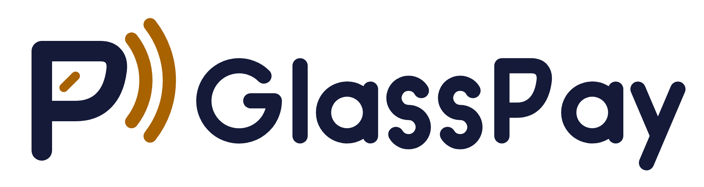

# GlassPay — guía de marca

**Símbolo:** P-Lente. La P de GlassPay tiene el cuenco en forma de lente Wayfarer, con su reflejo, y emite dos ondas: pagas mirando y hablando, sin tocar.

## Archivos

| Carpeta | Contenido |
|---|---|
| `logo/` | Maestros SVG: símbolo, horizontal, vertical y wordmark en versiones `on-dark`, `on-light`, `black`, `white` (y símbolo `amber`) |
| `png/` | PNG de alta resolución del símbolo y los logotipos |
| `app-icon/` | Icono de app 1024 px (normal y tintado), `brandmark.svg` y vistas previas de iOS y Android |
| `web/` | `favicon.svg`, `favicon.ico` (16/32/48), `apple-touch-icon.png`, `icon-192.png`, `icon-512.png` |
| `presentation/` | Presentación con maquetas (`glasspay-brand.html` y `slides/`) |
| `exploration/` | Las cuatro rondas de conceptos descartados, solo como historial |
| `build.py` | Genera todo lo anterior y los iconos de iOS y Android desde una sola geometría |

No edites los SVG a mano: cambia `build.py` y vuelve a ejecutarlo (`python3 docs/brand/build.py`).
Los PNG se renderizan con el script de la skill de logos (`render_png.py`).

## Paleta Ámbar noche

| Nombre | HEX | RGB | Uso |
|---|---|---|---|
| Índigo noche | `#141A38` | 20, 26, 56 | Fondo de marca, icono de app, texto sobre claro |
| Ámbar | `#FFB547` | 255, 181, 71 | Ondas y reflejo sobre fondos oscuros |
| Ámbar profundo | `#A86200` | 168, 98, 0 | Ondas y reflejo sobre fondos claros |
| Crema | `#FFF6E8` | 255, 246, 232 | Fondo claro |
| Blanco | `#FFFFFF` | 255, 255, 255 | La P sobre fondos oscuros |

Contraste medido: ámbar sobre índigo 9.7:1, ámbar profundo sobre crema 4.4:1, índigo sobre crema 15.9:1, blanco sobre índigo 17.0:1.
El ámbar es el color del acento: solo en las ondas y el reflejo, nunca en la P.

## Tipografía

- **Wordmark:** letras dibujadas a medida con geometría propia (no es una fuente; no hay licencia que pagar). La P del nombre repite la lente del símbolo.
- **Interfaz:** la del sistema, SF Pro en iOS y Roboto en Android.

## Reglas de uso

- **Área de protección:** deja alrededor del logo al menos el ancho de la onda exterior más su separación (≈ 1/4 de la altura del símbolo).
- **Tamaños mínimos:** símbolo 16 px; logotipo horizontal 96 px de ancho; en impresión, símbolo 6 mm y horizontal 25 mm.
- **Fondos aprobados:** índigo, crema, blanco o negro. Sobre fotos, usa la versión `white` o `black` con suficiente contraste.
- **Un solo color:** usa `black`, `white` o `amber` cuando no se puedan imprimir dos colores.

**No hagas esto:**
- Cambiar los colores, ponerle degradados o sombras, ni inclinar, deformar o rotar el logo.
- Quitar el reflejo o una de las ondas, ni separar el símbolo del nombre con otra distancia.
- Usar el ámbar claro sobre fondos claros: pierde contraste. Usa el ámbar profundo.
- Combinarlo con la marca de PayPal, de Meta o de Ray-Ban. GlassPay no usa marcas de terceros.

## Pendientes

- Hacer una búsqueda profesional de marcas parecidas antes de registrar el logo.
- Los SVG usan trazos (`stroke`). Si una imprenta pide contornos, conviértelos en Illustrator o Inkscape (*Trazo a contorno*).
